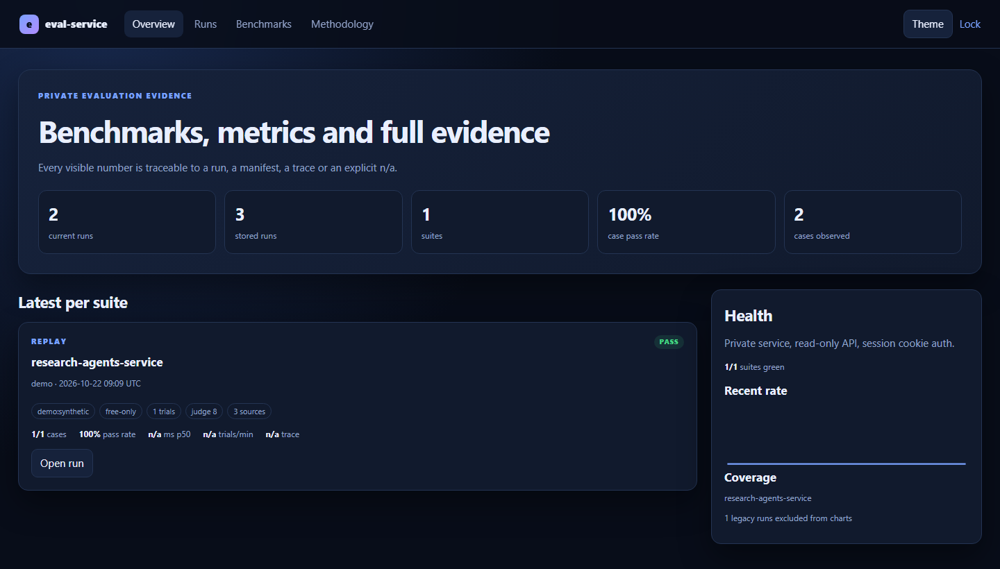
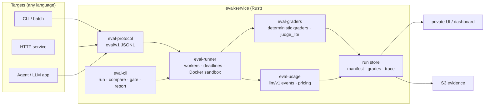
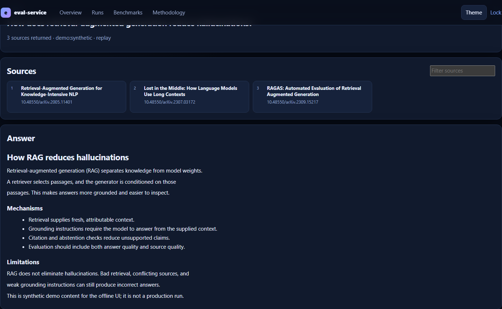
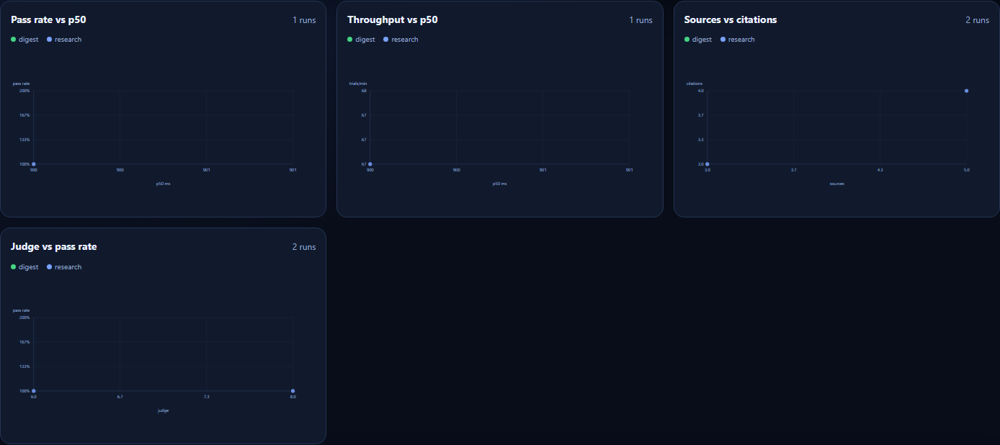

<div align="center">

# eval-service

**The measurement and evaluation layer for LLM-powered projects.**

One Rust engine. Any language. Evidence-backed quality, cost, latency, and reliability.

[](https://github.com/amagarzogonzalo/eval-service/actions/workflows/ci-fast.yml)
[](https://github.com/amagarzogonzalo/eval-service/actions/workflows/e2e-private-ui.yml)
[](https://github.com/amagarzogonzalo/eval-service/actions/workflows/security-dependencies.yml)
[](LICENSE)
[](Cargo.toml)
[](#toolchain)
[](#status-and-limitations)

[Quickstart](#quickstart) · [Architecture](#architecture) · [Documentation](docs/README.md) · [Testing](docs/testing.md) · [Security](#security)

</div>

> **Status:** private single-user production deployment; public source under MIT.
> The UI is not hosted publicly. This is not an agent framework or a multi-tenant
> service. It is the measurement layer for projects that already exist.



<sub>Synthetic demo store. Screenshots in this README are not production evidence.</sub>

## Why eval-service

- **One contract, any target.** A target implements a small adapter that speaks
  `eval/v1`; it can be Python, Rust, an HTTP service, LangGraph, or an ordinary CLI.
- **Evidence, not vibes.** Every displayed number traces to a run store, manifest,
  grade, or trace. Missing metrics stay `n/a`; they are never invented as zero.
- **Regression gates with names.** Baseline vs candidate comparisons cite the case
  and evidence that changed. Exit codes are stable: `0` pass, `1` regression,
  `2` infrastructure/configuration error.
- **Live LLM observation.** A loopback proxy records provider usage, enforces
  budgets, and can replay cassettes offline. Replay is never labelled live evidence.
- **Private by construction.** The production UI is loopback-only, token-session
  authenticated, read-only, and reached through an SSH tunnel.

## Two data paths, one dashboard

| Path | Question it answers | What it records |
|---|---|---|
| **Usage tracking** | *What does each project consume and what does it cost?* | Per-call `llm/v1` events: tokens, latency, errors, provider cost, task, context, day |
| **Benchmarking** | *Which variant performs best, and did a change regress anything?* | Graded cases, trials, manifests, latency, sources, judge results, evidence |

Both paths write to the same run store, so quality, cost, latency, and reliability
can be compared without copying data between systems.

## Architecture



The engine owns execution, measurement, comparison, and reporting. Targets own
their own code and dependencies. A subprocess is not treated as a security
boundary; use `--sandbox docker` when running untrusted targets.

## Evidence snapshot

> **Verified example, not a universal quality claim.** A RAG research run passed
> **2/2** cases with **50 sources**, **7 citations**, p50 **89,029 ms**, and an
> advisory judge score of **9/10**. The upstream target is an external service;
> its LLM is recorded honestly as `target-service:remote`.

## Quickstart

Prerequisites: Rust 1.85+ (edition 2024) and Python 3.11+ for the Python
reference target. Node 22.19 is only needed for browser E2E.

```sh
make build    # or: cargo build -p eval-cli

./target/debug/eval run datasets/cv_demo/suite.yaml --ref baseline --set-baseline
# ... change something ...
./target/debug/eval run datasets/cv_demo/suite.yaml --ref work
./target/debug/eval compare --suite datasets/cv_demo/suite.yaml
# exit 0 = pass, 1 = regression/failure, 2 = infrastructure error
```

On Linux/macOS/WSL, `make check`, `make baseline`, `make work`, and `make compare`
wrap the same commands. `make quality` is the full Rust gate; `make help` lists
every target. Windows without `make` uses the raw cargo/eval commands.

### Add a project in minutes

```sh
./target/debug/eval onboard mytool --template cli --dir .
./target/debug/eval check mytool/suite.yaml --probe
```

`eval schema` is the machine-readable surface: grader kinds, presets, field paths,
protocol messages, suite keys, and exit codes. The contract is documented in
[`docs/integration.md`](docs/integration.md).

### Run the private UI against synthetic data

```sh
make demo-store
EVAL_SITE_API_TOKEN=demo EVAL_SITE_SIGNING_KEY=demo-only \
  python3 web/private_service.py --root web/private_ui --store demo-store \
  --port 8091 --allow-http-cookie
# open http://127.0.0.1:8091 and enter token: demo
```

The demo token and signing key above are intentionally fake and apply only to the
loopback demo. The production service is documented in
[`docs/runbook.md`](docs/runbook.md).

## See it

<p align="center">
  
  
</p>

The run view shows the query, source cards, the rendered answer, grades, judge
output, transcripts, and raw evidence files. The benchmark view compares current
and legacy runs by target, model, query, quality, latency, throughput, sources,
and judge score.

## Core commands

| Command | What it does |
|---|---|
| `eval schema [--compact]` | Print the machine-readable platform manifest — read this first |
| `eval onboard NAME --template cli\|llm\|agent [--dir DIR]` | Scaffold → probe → baseline in one command |
| `eval check SUITE.yaml --probe` | Validate a suite and test the adapter handshake |
| `eval run SUITE.yaml [--ref work] [--sandbox docker]` | Execute, grade, and store a run |
| `eval compare --suite SUITE.yaml` | Compare baseline vs candidate; `0/1/2` exit codes |
| `eval gate --suite SUITE.yaml [--promote]` | Enforce provenance policy before promotion |
| `eval dashboard --workspace eval-workspace.toml` | Build the static portfolio dashboard |
| `eval proxy ...` / `eval cassette ...` | Observe live LLM calls or replay recorded exchanges |
| `eval usage-import` / `eval usage-report` | Store and aggregate `llm/v1` usage events |

The full surface is self-describing: run `eval --help` or `eval schema`. See
[`docs/tutorial.md`](docs/tutorial.md) for a zero-to-gated-suite walkthrough.

`examples/llm_calls/` shows how an ordinary LLM app plugs in: extraction,
constrained classification, coverage-graded summarization, and a two-variant
fixture benchmark behind a provider-neutral interface. Offline runs use a
deterministic fake; live calls are an explicit opt-in smoke test, never the
default CI path.

## Toolchain

- MSRV **1.85** (edition 2024), checked in CI.
- Windows: the GNU toolchain (`stable-x86_64-pc-windows-gnu`) plus MinGW-w64
  `gcc`/`dlltool` links out of the box; MSVC works with Visual Studio Build
  Tools. CI covers Linux, Windows, and ARM64.
- `$PYTHON` in suite target argv resolves via `EVAL_PYTHON`, then `python3` or
  `python` on PATH.

## Documentation map

| Start here | Integrate | Operate | Quality and security |
|---|---|---|---|
| [Architecture](docs/architecture.md) | [Integration contract](docs/integration.md) | [Production runbook](docs/runbook.md) | [Testing](docs/testing.md) |
| [Benchmark method](docs/benchmark-method.md) | [Protocol v1](docs/03-protocol-v1.md) | [Run metrics](docs/run-metrics.md) | [Quality gates](docs/quality.md) |
| [Case study](docs/case-study.md) | [Domain model](docs/04-domain-model.md) | [Observability](docs/observability.md) | [Security threat model](docs/security-threat-model.md) |
| [Tutorial](docs/tutorial.md) | [Proxy and cassettes](docs/proxy.md) | [Sandbox](docs/sandbox.md) | [Judge calibration](docs/judge-calibration.md) |
| [ADR index](docs/adr/) | [LLM events](docs/llm-events.md) | [PR gate](docs/pr-gate.md) | [Release checklist](docs/release-checklist.md) |

The complete index, including historical design documents and lane-specific
runbooks, is [`docs/README.md`](docs/README.md). The coding-agent workflow is
[`AGENTS.md`](AGENTS.md); releases are tracked in [`CHANGELOG.md`](CHANGELOG.md).

## Testing and quality

```sh
make quality        # fmt + clippy + check + workspace tests + rustdoc
make python-test    # private service, store tools, judge helpers, UI contracts
make python-lint    # ruff + compileall

cd e2e
npm ci
npx playwright install chromium
npm test            # private UI browser E2E against a synthetic demo store

cargo deny check    # advisories, licenses, bans, registries
```

CI runs the Rust gate on Linux, Windows, and ARM64, plus MSRV 1.85, an offline
test run, Python lint/tests, full-history secret scanning, the private UI E2E,
dependency review, `cargo-deny`, the replay-only PR gate, and Terraform validation.
The exact matrix and known gaps are in [`docs/testing.md`](docs/testing.md) and
[`docs/quality.md`](docs/quality.md).

## Security

- Secrets are never committed. `gitleaks` scans full git history in CI; `.env`
  files are ignored; live credentials exist only in the launching environment.
- `cargo-deny` enforces RustSec advisories, an SPDX license allowlist, and
  crates.io-only sources. PRs get dependency review at `high` severity.
- The private UI has no write endpoints, binds to loopback, uses signed
  `HttpOnly` session cookies, and serves a strict CSP.
- **Scope:** these are dependency/vulnerability checks and operational controls,
  not a formal security audit. See [`SECURITY.md`](SECURITY.md) and the
  [threat model](docs/security-threat-model.md).

## Repository layout

<details>
<summary>Show the workspace layout</summary>

```text
crates/
  eval-core/        domain types, suite config, workspace registry, file store, redaction
  eval-protocol/    eval/v1 wire types, validation, generated JSON Schema
  eval-runner/      subprocess management, worker pool, deadlines, Docker sandbox
  eval-graders/     graders, statistics, gate decisions, calibration, dashboard
  eval-usage/       llm/v1 events, idempotent store, pricing, aggregation, collector
  eval-proxy/       loopback OpenAI-compatible observer, budgets, cassettes
  eval-telemetry/   W3C trace propagation and local OTel export
  eval-cli/         run, compare, gate, report, init, onboard, proxy, usage, watch
adapters/           Python and Rust reference targets
integrations/       real project adapters and suites
datasets/           demo, digest, research, security, and calibration fixtures
examples/llm_calls/ LLM-app evaluation examples (offline fake + opt-in live)
infra/              AWS runner, observability stack, Docker sandbox
deploy/             private service, Caddy, retention units
web/                static benchmark page, private UI, judge helper
e2e/                Playwright browser E2E for the private UI
scripts/            demo store, verification, retention, restore, calibration export
docs/               contracts, runbooks, ADRs, testing, assets
protocol/           generated eval-protocol-v1 schema and transcripts
pricing/            versioned, illustrative fixture rates
Makefile            canonical developer and runner targets
```

</details>

## Status and limitations

| Area | Current state |
|---|---|
| Code | Public GitHub repository, MIT license, CI and secret scanning |
| UI | Private, loopback-only, token-authenticated, reached by SSH tunnel |
| Runs | `/var/lib/eval-runs`, mirrored to S3; manifests on current runs |
| Schedule | Weekly GitHub Actions jobs on a self-hosted ARM64 runner |
| Cost | Infrastructure is not free; AWS credits currently cover the VM |
| Not yet | Multi-user auth, public ingress, alerting/SLOs, human judge calibration |

- A subprocess is **not a sandbox**. Env allowlisting, cwd confinement, and
  redaction are implemented; use OS-level isolation for untrusted targets.
- Statistics are hand-rolled Wilson/bootstrap/pass@k with reference tests.
  Per-case output is diagnostic; gate failures cite evidence.
- `judge_lite` is deterministic (citations + length). Live judges remain opt-in.
- Fixture benchmarks and demo data are synthetic and labelled everywhere; they
  are never evidence about real models.
- No human-labelled calibration dataset exists, so judge scores remain advisory
  and are never promoted.

## Contributing

Read [`CONTRIBUTING.md`](CONTRIBUTING.md) and [`AGENTS.md`](AGENTS.md). A change
is not done until the local gate and CI are green:

```sh
make quality
make python-test
make python-lint
```

Do not commit secrets, weaken a gate to make a change pass, or modify a target
repository to make it evaluable. Integrations live in `integrations/` in this
repository.

## License

MIT. See [`LICENSE`](LICENSE).
