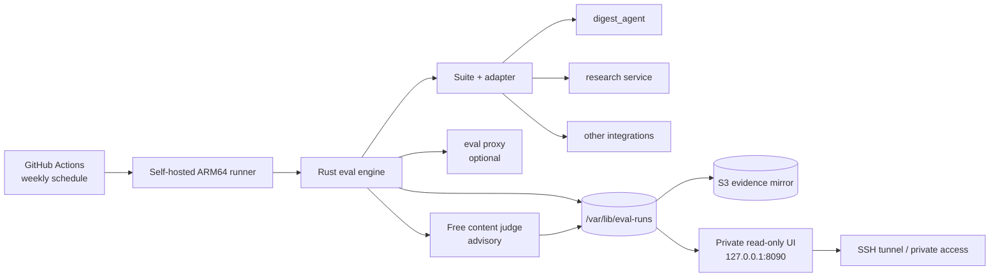

# Architecture

`eval-service` is a measurement and evaluation platform. It is intentionally
not an agent framework: the engine owns execution, evidence, grading, and
reporting, while each target project keeps its own implementation.

## System view

## Layers

| Layer | Responsibility |
|---|---|
| `crates/eval-core` | Domain types, suites, stores, manifests, metrics, redaction |
| `crates/eval-protocol` | Versioned `eval/v1` wire contract and generated schema |
| `crates/eval-runner` | Subprocess lifecycle, deadlines, worker pool, failure taxonomy |
| `crates/eval-graders` | Deterministic graders, statistics, gates, portfolio reports |
| `crates/eval-usage` | `llm/v1` usage events, pricing, aggregation |
| `crates/eval-proxy` | Loopback OpenAI-compatible observer, budgets, cassettes |
| `crates/eval-cli` | `eval run/compare/report/dashboard/...` |
| `integrations/` | Thin adapters and suites for real target projects |
| `web/` | Private read-only evidence UI and free judge |
| `infra/` | VM, observability, and sandbox definitions |

## One run

1. `eval run` loads a suite and validates its cases and graders.
2. The runner launches the target adapter with the `eval/v1` JSONL contract.
3. The adapter calls the target application; logs go to stderr only.
4. The engine records observations, grades, and a `run-manifest/v1`.
5. Metrics (`run-metrics/v1`) separate observed values from `n/a`.
6. The run directory is the canonical evidence; S3 is the durable mirror.
7. The private UI reads the store; it never writes to it.

Deterministic checks gate a run. The content judge is advisory and fails closed
on non-free models, malformed output, or non-zero cost.

## Trust boundaries

- The private UI is not a public service. It is bound to loopback and reached
  through a private tunnel; the API token is exchanged for a signed HttpOnly
  session cookie.
- Target projects are black boxes. This repository never edits them.
- Secrets remain in the launching environment or `/etc/eval/*.env`. They are
  never written into run evidence.
- The subprocess runner is not an OS sandbox. Untrusted targets require the
  Docker sandbox described in `docs/sandbox.md`.

## Why the layout is small

The engine does not import target code. Adding a project means adding an
adapter and a suite in `integrations/`, not changing the Rust engine. This is
the main architectural constraint that keeps the platform reusable.

## Current vs legacy evidence

A current run has a structured manifest with a model and provenance. Runs
without that evidence are shown as legacy: they remain inspectable, but are
excluded from default benchmark charts and model aggregates. This avoids
silently comparing incomplete historical runs with current evidence.
